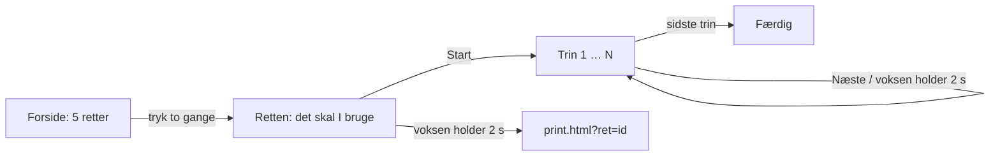

# Tumbi Køkken

En kogebog til børn ca. 5-9 år, som laver mad sammen med en voksen. Ét trin pr. skærm, store billeder og knapper, oplæsning ved tryk, timer og en print-side til den voksne. Bygget til iPad på langs; virker også på telefon og pc.

Fase 1: statisk PWA uden byggetrin og uden afhængigheder (HTML, CSS og ES-moduler). Ikke udgivet endnu.

## Sådan hænger det sammen

| Del | Fil |
|---|---|
| Skærmene og ruterne (`#/ret/<id>/trin/<nr>`) | `app.js`, `app.css`, `index.html` |
| Oplæsning: `lyd/<fil>.mp3`, hvis den står i `lyd/liste.json`, ellers dansk stemme i browseren | `js/tale.js` |
| Timer med sluttid (overlever skærmskift og genindlæsning), bip og skærm-lås | `js/timer.js`, `js/tid.js` |
| Gemt i browseren: kun `kog-v1` = `{ v, sidste, timer }` | `js/lager.js` |
| Print til den voksne (A4) | `print.html`, `print.css`, `js/print.js` |
| Offline: service worker med `kog-`-caches | `sw.js`, `manifest.webmanifest` |
| Opskrifterne: schema.org/Recipe + et `tumbi`-felt | `opskrifter/<id>.json`, `opskrifter/index.json` |
| Navne på verber, ingredienser og grafik | `js/katalog.js` |
| Grafik (pladsholdere i fase 1) | `grafik/*.svg`, `ikoner/` |

## Kommandoer

Alle køres i Git Bash eller PowerShell i `D:\Claude\Kogebog`.

| Hvad | Kommando |
|---|---|
| Alle node-tests (opskrifter, validator, tid, service worker) | `node test/koer-alle.js` (eller `npm.cmd test`) |
| Kun opskrifterne | `node test/test-opskrifter.js` |
| Lokal server | `py -m http.server 8091 --bind 127.0.0.1 --directory D:/Claude/Kogebog` — åbn http://127.0.0.1:8091/ (aldrig `file://`) |
| Browsertest (WebKit, 3 skærme) — tung, kør gennem låsen | `NODE_PATH=C:/Users/Jimmy/AppData/Roaming/npm/node_modules/@playwright/cli/node_modules bash ~/.claude/tung-koersel.sh "kogebog: e2e" node test/test-e2e.js [http://127.0.0.1:8091] [mappe-til-skærmbilleder]` — kun en del: `E2E_DELE=hele,print,tastatur,fejl` og `E2E_SKAERME=ipad,iphone,desktop` |
| Lav hjemmeskærm-ikonerne (PNG) ud fra `ikoner/ikon.svg` | `NODE_PATH=… bash ~/.claude/tung-koersel.sh "kogebog: ikoner" node vaerktoej/lav-ikoner.js` |

`?hurtig=1` i adressen gør alle timere 2 sekunder lange (kun til test).

## En ny opskrift

1. Læg `opskrifter/<id>.json` (se en af de fem) og skriv id'et i `opskrifter/index.json`.
2. Kør `node test/test-opskrifter.js`. Den siger præcis, hvad der er galt, fx kniv uden `"voksen": true` og `voksen_hjaelp`, rå kød uden håndvask bagefter, eller et trin over 9 ord.
3. Skriv den nye fil i `FILER` i `sw.js`, og tæl `VERSION` op (testen `test-sw.js` fejler, hvis en fil mangler).

## Regler i koden

- Tekst fra opskrifterne sættes altid som tekst (`textContent`), aldrig som HTML. Sikkerhedspolitikken (CSP) i `index.html` og `print.html` tillader kun egne filer.
- Ingen persondata om børn i filer: skriv «børn ca. 5-9 år».
- Ingen afhængigheder i appen. Playwright er kun et testværktøj.
