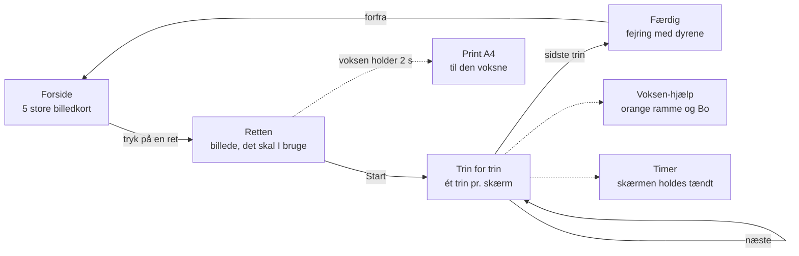

# Tumbi Køkken — gennemgang

18-10-2026 · forslag til fase 1-3, intet er udgivet. Bygger på lørdags-researchen 17-10 (`Heimdal/docs/loerdag-17-10/`: emne 3 og 4 og den samlede anbefaling).

## Kort fortalt

- **En lille kogebog på iPad**, hvor et barn (ca. 5-9 år) og en voksen laver mad sammen. Der er ét trin pr. skærm med et billede og en kort sætning, og stemmen læser op.
- **Barnet** måler, hælder, rører, ælter og smager. **Den voksne** tager kniven og varmen. Appen viser det med en orange ramme og kok-bjørnen Bo.
- **Den er sin egen app under Tumbi-brandet**, ved siden af Lystårnet: samme origin, egen mappe og eget cache-præfiks `kog-`.
- **Hver ret er én JSON-fil** (schema.org/Recipe plus egne felter under `tumbi`), og den samme fil giver både skærmen og A4-printet.
- **MVP er 5 retter.** Billederne kommer fra ChatGPT, og indtil videre bruger appen iPad'ens egen stemme.

Barnet kan næsten ikke læse, så det skal klare sig med billeder, store knapper (mindst 52 px) og stemmen. Mellemrum og piletaster på tastaturcoveret virker også. Den voksne får detaljerne i små noter og på printet. Standarden er iPad i landskab, men iPhone (390x844) og desktop skal også virke.

## Hvorfor sin egen app

| | Lystårnet (spillet) | Tumbi Køkken |
|---|---|---|
| Brand og origin | Tumbi · jimmyfabe.github.io | Tumbi · jimmyfabe.github.io |
| Sti | `/Lystaarnet/` | `/Kogebog/` (forslag) |
| Cache og `localStorage` | præfiks `mat-` | præfiks `kog-`, og appen sletter kun sine egne caches |
| Gemte data | børnenes fremskridt (deres eneste kopi) | intet fremskridt, kun små indstillinger |
| Udgivelse | automatisk efter hver grøn fase | først når Jimmy siger ja |

Kogebogen deler hverken fremskridt eller sætninger med spillet. Lå den som et modul i Lystårnet, ville hver opskrift ramme Lystårnets hooks, den automatiske udgivelse og børnenes gemte data. Et link-kort på Lystårnets forside kan komme senere.

## MVP: 5 retter

| Ret | id | Barnet | Den voksne (kniv/varme) |
|---|---|---|---|
| Pandekager | `pandekager` | måler, hælder, rører, smager | steger, vender |
| Frikadeller | `frikadeller` | rører farsen, former, vasker hænder | steger, vender |
| Kødsovs med spaghetti | `koedsovs` | hælder tomater i, rører | hakker løg, brunerer kødet, koger pasta |
| Boller | `boller` | måler, ælter, venter på hævningen, ruller | passer ovnen |
| Chorizo-pasta | `chorizo-pasta` | hælder, rører osten i, smager | skærer chorizo og løg, steger, koger |

Chorizo-pastaen bygger på Jimmys egen opskrift (efter «Ibsens mad») og skrives om med egne trin. Al tekst er vores egen, og vi låner kun ingredienslister, som er fakta.

## Skærmene



- **Forside:** tre afsnit, aftensmad, bagning og søde sager (`opskrifter/index.json`), hvert med en overskrift af billede og ord (en gryde, en ovn og en kage) og et kort pr. ret. Kortenes cirkel har afsnittets farve. Fra oktober 2026 er der 13 retter, så siden ruller; den første række ses uden at rulle. Ingen anden navigation. Første tryk siger navnet, andet tryk åbner retten.
- **Trin for trin:** et verbum-billede og én sætning (højst ca. 8 ord), der læses op af sig selv. Knapper: igen, tilbage, næste.
- **Voksen-hjælp:** orange ramme, Bo og «Nu hjælper den voksne». Næste kræver et hold i 2 s som Lystårnets voksen-hold, og print ligger bag samme hold.

## Dataformat

Hver ret er én fil, `opskrifter/<id>.json`, og `opskrifter/liste.json` giver rækkefølgen på forsiden. Standardfelterne følger [schema.org/Recipe](https://schema.org/Recipe). Alt vores eget ligger under `tumbi`, så andre programmer stadig kan læse opskriften.

| Felt | Hvor | Indhold |
|---|---|---|
| `name`, `image`, `recipeYield`, `totalTime`, `recipeIngredient`, `tool` | retten, skal | standard schema.org. Tider skrives som `PT15M`, og `image` er `billeder/ret-<id>.png` |
| `description`, `prepTime`, `cookTime`, `inLanguage` | retten, valgfri | standard schema.org |
| `recipeInstructions` | retten, skal | en liste af `HowToStep`, hvor `text` er det, der vises og læses op |
| `tumbi.verbum` | hvert trin, skal | et af de 24 verber: `roere` `haelde` `skaere` `aelte` `rulle` `vende` `stege` `koge` `maale` `vaske-haender` `vente` `smage` og (fra 18-10) `smoere` `mose` `bage` `piske` `drysse` `rive` `pensle` og (fra 19-10) `tage-ud` `si` `kagerulle` `pakke-ind` `smuldre` |
| `tumbi.voksen` | trin, valgfri | `true`, når en voksen skal hjælpe (kniv, varme, ovn). Giver «Hent en voksen», og kræver `voksen_hjaelp` |
| `tumbi.voksen_hjaelp` | trin, sammen med `voksen` | `"kniv"` eller `"varme"` (komfur, ovn, kogende vand, varm pande) |
| `tumbi.timer_sek` | trin, valgfri | heltal sekunder, som giver en stor timer |
| `tumbi.note` | trin, valgfri | detaljer til den voksne. Noten vises småt og på printet, men læses ikke op |
| `tumbi.id`, `tumbi.version`, `tumbi.afproevet`, `tumbi.kilde` | retten, skal | id er det samme som filnavnet, `version` er `1`, og `afproevet` er `false`, til I har lavet retten |

Her er et forkortet eksempel. Det fulde eksempel står i `chatgpt-app-prompt.md`.

```json
{
  "@context": "https://schema.org",
  "@type": "Recipe",
  "name": "Pandekager",
  "image": "billeder/ret-pandekager.png",
  "recipeYield": "4 personer",
  "totalTime": "PT50M",
  "recipeIngredient": ["2,5 dl hvedemel", "3 æg", "4 dl mælk"],
  "tool": ["skål", "piskeris", "pande"],
  "recipeInstructions": [
    { "@type": "HowToStep", "text": "Hæld melet i skålen.", "tumbi": { "verbum": "haelde" } },
    { "@type": "HowToStep", "text": "Lad dejen hvile i 10 minutter.", "tumbi": { "verbum": "vente", "timer_sek": 600 } },
    { "@type": "HowToStep", "text": "Steg pandekagen.", "tumbi": { "verbum": "stege", "voksen": true, "voksen_hjaelp": "varme", "timer_sek": 60, "note": "Middel varme, lidt smør på panden." } }
  ],
  "tumbi": { "id": "pandekager", "version": 1, "afproevet": false, "kilde": "Egen tekst" }
}
```

**Validatoren** (`node test/test-opskrifter.js`, kun Node's standardbibliotek) skal tjekke, at filen er gyldig JSON, at id er lig filnavnet, at verber og nøgler er kendte, at `skaere` har `kniv`, og `stege`/`koge`/`vende` har `varme`, at `timer_sek` er et positivt heltal, at sætningerne er korte, og at billedfilerne findes. «Vask hænderne» efter rå kød og æg tjekkes ved gennemlæsning.

## Grafik

- **Tre faste dyre-hjælpere:** **Bo** er en kok-bjørn og den voksnes hjælper ved kniv og varme. **Rosa** er en lille ræv og barnets hjælper. **Pip** er et lille pindsvin, hjælper nr. 2 og den, der venter med timeglasset. Så kan to børn skiftes («Rosas tur», «Pips tur»).
- **Billederne er 12 verbum-piktogrammer** (`verbum-<id>.png`), **5 ret-billeder** (`ret-<id>.png`), `dyr-<navn>.png`, `app-ikon.png` og `faerdig.png`. De er i flad vektorstil med få farver og gennemsigtig baggrund og har ingen tekst.
- Billederne laves i ChatGPT efter `chatgpt-grafik-prompt.md` (25 PNG'er). Indtil de kommer, bruger appen simple pladsholdere. Billederne kan bevæge sig lidt med CSS (vippe, dreje), men ikke ved `prefers-reduced-motion`.

## Stemme

- **Nu (pladsholder):** iPad'ens egen danske stemme via `speechSynthesis` med `lang = "da-DK"`. Den koster 0 kr og kræver ingen filer. Den kræver en dansk stemme på iPad'en og sandsynligvis et tryk, før den taler første gang (ikke afprøvet).
- **Google Chirp 3 HD er udelukket, medmindre Google bekræfter det skriftligt.** Googles Service Specific Terms, punkt 20(d), forbyder en generativ AI-tjeneste i en tjeneste rettet mod personer under 18 år. Der er ingen undtagelse for færdige lydfiler. Kilde: Heimdal `docs/loerdag-17-10/00-samlet-anbefaling.md`, «Ændringer efter dommen» (18-10-2026).
- **Senere:** en lokal dansk kvindestemme eller Azure, som færdige MP3-filer (ca. 200 sætninger og ca. 2 MB). En lyttetest afgør valget:
  - **Røst v3** (lokalt, kræver PyTorch og Jimmys ja). Kilden har ikke afgjort, hvilken af «Mic» og «Nic» der er kvinden.
  - **Piper-kvinde trænet på CoRal-TTS** (langsigtet). Træningen kræver en GPU med mindst 8 GB eller en lejet GPU.
  - **Azure `da-DK-ChristelNeural`.** Vilkårene er kun delvist læst (Heimdal `docs/stemmer/azure-vilkaar.md`). Den gratis F0-ressource må ikke bruges til MP3-filer, der udgives, og stemmen skal oplyses som syntetisk.
- Den danske Piper-mandestemme er afvist og bruges ikke. Teksten er den samme, og det er kun motoren, der skiftes.

## Print og timer

- **A4-print fra samme JSON:** printet har titel, portioner og tid, en indkøbsliste med afkrydsning og «Ingredienser | Sådan gør du» i to spalter. Voksen-trin er mærket med kniv eller varme, og noterne står med. Er `afproevet` false, står der «Ikke afprøvet», og nederst står «Tjek selv pakkerne for allergener». Claude gemmer printet som PDF på Drev, så det kan printes fra telefonen.
- **Timer:** `timer_sek` giver en stor cirkel, der tømmes, og en lyd, når tiden er gået. Skærmen holdes tændt med Screen Wake Lock, som kom i Safari 16.4, virker fra hjemmeskærmen fra iPadOS 18.4 og kræver HTTPS. Timeren regner fra sluttidspunktet, så den ikke går bagud, og den kører kun, mens appen er åben.

## Risici

| Risiko | Sådan håndteres den |
|---|---|
| Kniv | `skaere` er altid voksen-hjælp: Bo, orange ramme og hold i 2 s |
| Varme (komfur, ovn, kogende vand) | `stege`, `koge` og `vende` er altid voksen-hjælp. Det samme gælder, når barnet rører i en varm gryde |
| Rå kød og æg | et trin med «Vask hænderne» bagefter |
| Allergi | Allergier står ikke i appen: der er ingen allergimærker, intet filter og intet om, hvem der tåler hvad. Den voksne læser pakkerne, og printet minder om det |
| Stemmen mangler eller lyder dårligt | teksten står altid på skærmen, og knappen «igen» læser op igen |
| Skærmen slukker | Wake Lock holder den tændt. Virker det ikke, viser timeren stadig den rigtige tid, når skærmen tændes igen |
| Samme origin som Lystårnet og LEGO | eget præfiks `kog-` og egen service worker i `/Kogebog/` |
| Offentligt repo | ingen persondata, ingen fotos af børn og ingen nøgler |
| Ophavsret | egne trin og egne billeder. Vi låner kun ingredienslister og idéer |

## Faser

1. **Køkkenklar MVP:** format og validator, de 5 retter som JSON, skærmene, voksen-hjælp, timer med Wake Lock, iPad-stemmen, A4-print og pladsholdergrafik. Det testes i WebKit på iPad i landskab, iPhone og desktop.
2. **Billeder, stemme og offline:** ChatGPT-billederne lægges ind (skaleret ned, så pakken er lille), den valgte stemme kommer ind som MP3, der kommer en service worker med `kog-`, og appen udgives på GitHub Pages.
3. **Mere for barnet:** «Find tingene» med ingredienserne som billeder, tur-skifte mellem Rosa og Pip, flere retter (ChatGPT skriver JSON, og Claude tjekker) og et link-kort fra Lystårnet.

## Afventer Jimmy

1. **Billeder:** Godkend dyrenes navne (Bo, Rosa og Pip) først, for de indgår i filnavnene. Læg derefter de 25 billeder fra ChatGPT i Drev-mappen `Claude/Kogebog/billeder`.
2. **Stemme:** lyttetesten og dit valg mellem Røst, en Piper-kvinde og Azure. Google Chirp er udelukket, medmindre Google bekræfter skriftligt. Indtil da bruger appen iPad'ens egen stemme.
3. **Udgivelse:** Må `Kogebog` blive et offentligt repo med GitHub Pages på `/Kogebog/`? Stien kan ikke skiftes senere, uden at ikoner og indstillinger på iPad'erne forsvinder.
4. **Domænet tumbi.dk:** Skal det købes nu (en lille udgift)? Bruges det som eget domæne på GitHub Pages, skifter appen origin. Så forsvinder gemte data og hjemmeskærmsikoner, og det kræver derfor en plan først (ikke undersøgt i detaljer).
